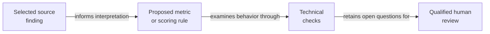

<h1>
<picture>
  <source media="(max-width: 600px)" srcset="assets/research/v1/banner-mobile-dark.svg">
  
</picture>
</h1>

[](docs/research-summary.md) [](PUBLICATION_SNAPSHOT.md) [](LICENSE)

Which failures should disqualify a persuasive answer, and who can justify that judgment? The Catholic Doctrinal Fidelity Index (CDFI) proposes scoring rules and review procedures for evaluating AI responses within the SAICRED project. [Research question](docs/research-summary.md).

[Policy reader: understand in 90 seconds](#research-in-90-seconds) · [Reviewer: inspect evidence and limits](docs/current-review.md) · [Engineer: run the calculator](docs/reference-verification.md)

## At a glance

| | Current account |
| :--- | :--- |
| Purpose | Connect domain-specific evaluation rules with sources, scoring and review. [Method](TRANSLATION-METHOD.md) |
| Status | Evolving. Scoring-contract reconciliation and human theological validation remain open. [Research account](docs/research-summary.md) |
| Evidence type | Source translations, a public calculator and attributed reports from a separate production pipeline. [Review guide](docs/current-review.md) |
| Version | Archived v1.5, May 31, 2026. The active branch includes later changes. [Publication record](PUBLICATION_SNAPSHOT.md) |
| License | Declared Apache-2.0. [Preserved license](LICENSE) · [attribution](NOTICE) |
| Cite | [Archived v1.5: 10.5281/zenodo.20475185](https://doi.org/10.5281/zenodo.20475185) · [citation metadata](CITATION.cff) |

**The method remains provisional.** Differences among the formula, configuration and calculator require reconciliation. Qualified human theological review remains open. The public calculator supplies a bounded implementation demonstration. [Current status](docs/research-summary.md), [contract limits](docs/current-review.md#known-limits).

## Research in 90 seconds

A fluent response can still mishandle a source or a doctrinal distinction. CDFI asks how an evaluation should represent those failures and who should review its judgment. Its contribution connects selected research ideas to proposed metrics, scoring rules, score caps and reliability checks. A score cap limits a response's numerical score when a declared failure occurs. [Research account](docs/research-summary.md), [translation method](TRANSLATION-METHOD.md).

The work translates selected ideas from seven AI safety publications into a Catholic doctrinal evaluation context. Those translations contain researcher judgments about how findings apply to a new setting. Reviewers can inspect the sources, reasoning and proposed rules separately. [Source-to-method map](TRACEABILITY.md), [claim packs](claims/).

The current evidence leaves the validity of particular weights, thresholds and institutional uses open. Technical consistency checks have a narrower scope than qualified theological review. The next steps are to reconcile the scoring contract, reproduce results from exact inputs and complete the required human assessment. [Research limits](docs/research-summary.md#limits-and-next-evidence), [validation status](docs/governance/cdcf-compliance/c4-validation-status.md).

## Method in brief



The text sequence is: identify a source claim, explain the domain interpretation, propose a scoring rule, check its behavior and obtain qualified human review. The diagram represents a method under development. It leaves empirical effectiveness and theological validity open. [Translation method](TRANSLATION-METHOD.md), [research status](docs/research-summary.md).

## Evidence and known limits

| Material | What is available | What remains open |
| :--- | :--- | :--- |
| Research translations | Seven source publications and eight machine-readable claim packs. [Traceability](TRACEABILITY.md) · [claim index](claims/README.md) | Source findings, researcher inferences and proposed design choices require separate assessment. [Translation method](TRANSLATION-METHOD.md) |
| Public calculator | Four built-in demonstrations of score calculation and caps. [Calculator](engine/cdfi_calculator.py) | Input scales, weights and gate handling differ across artifacts. [Current review](docs/current-review.md#known-limits) |
| Reported SAICRED results | Attributed summaries of the external production pipeline. [Results summary](examples/saicred-v2/results-summary.md) | Public files alone cannot reproduce the private pipeline or settle conflicting reported values. [Review guide](docs/current-review.md#reported-results-and-human-review) |
| Human review | Named responsibilities and proposed publication gates. [Validation status](docs/governance/cdcf-compliance/c4-validation-status.md) | Authority classification and human theological validation remain pending. [Current research status](docs/research-summary.md) |

## The SAICRED project

SAICRED means Standard for Assessing AI for Catholic Reliability and Doctrinal Fidelity. Its project leadership, production engineering and CDFI methodology have distinct contributors. The following account preserves the [existing project contribution record](README-2026-11-03.md#the-saicred-project).

| Role | Person | Recorded contribution |
| :--- | :--- | :--- |
| Project Lead | Filip Ponulak, PhD | Originated SAICRED, designed its overall framework and evaluation criteria, and holds theological authority and publication ownership. |
| Lead Engineer | Naveen Kumar Puppala | Built the production pipeline, including automated judging, metric computation and the results dashboard. |
| Evals Expert | Mark Julius Banasihan | Developed the CDFI scoring architecture and evaluation governance methodology. |
| Team member for future work | William J. Benjamin, PhD | Joined for future work; this credit attributes no contribution to the existing release. |

The framework citation identifies Banasihan's CDFI work. It preserves the wider project's separate leadership and contributor credits. Named participation alone leaves independent validation unestablished. [Contribution and citation boundary](README-2026-11-03.md#the-saicred-project), [publication provenance](PUBLICATION_SNAPSHOT.md).

## Reproduce the public demonstration

The [verification guide](docs/reference-verification.md) gives exact commands, the four current outputs and their limits. The calculator uses Python's standard library and makes no model calls. The private production data and judge-reliability suite require separate access and evidence. [Calculator](engine/cdfi_calculator.py), [validation-status register](docs/governance/cdcf-compliance/c4-validation-status.md).

## AI-assisted research disclosure

The project records Claude assistance with methodology, drafting, scoring architecture and repository construction during March to May 2026. Gemini 2.5 Flash serves a separate role as the reported automated judge. Mark Julius Banasihan retains responsibility for adopting material within his CDFI work. [AI-use disclosure](docs/ai-use-disclosure.md).

The inspected record lacks a complete task-level model history and a uniform record of human checks for every generated contribution. Reported technical checks, author acceptance and qualified theological review retain separate scopes. [Disclosure and verification limits](docs/ai-use-disclosure.md), [validation status](docs/governance/cdcf-compliance/c4-validation-status.md).

## Cite the archived release

This block renders the existing archived-release identity in [CITATION.cff](CITATION.cff). For later development, also record the exact Git commit. The active branch and archived v1.5 snapshot remain separately identifiable. [Publication record](PUBLICATION_SNAPSHOT.md).

```bibtex
@software{banasihan2026cdfi,
  author = {Banasihan, Mark Julius},
  title = {CDFI Framework: Evaluation Governance Infrastructure for Domain-Specific AI Doctrinal Benchmarking},
  year = {2026},
  month = may,
  version = {1.5},
  doi = {10.5281/zenodo.20475185},
  url = {https://doi.org/10.5281/zenodo.20475185},
  note = {Archived release, May 31, 2026}
}
```

<details>
<summary>Technical catalog, prior entry and publication history</summary>

The [complete prior README](README-2026-11-03.md) preserves the entry at [audit commit b2d635c](https://github.com/node-and-norm/cdfi-framework/tree/b2d635c803a0ce4ee1be3839a7d7c251adc2d60a).

- [Full translation method](TRANSLATION-METHOD.md)
- [Historical limitation register](LIMITATIONS.md)
- [Claim-pack index](claims/README.md)
- [Archived publication identity](PUBLICATION_SNAPSHOT.md)
- [Change history](CHANGELOG.md)

</details>

Evaluation governance research by [Mark Julius Banasihan](https://orcid.org/0009-0001-8121-2878). [Node & Norm](https://nodeandnorm.org/) · [Research integrity](https://nodeandnorm.org/about/research-integrity/).
